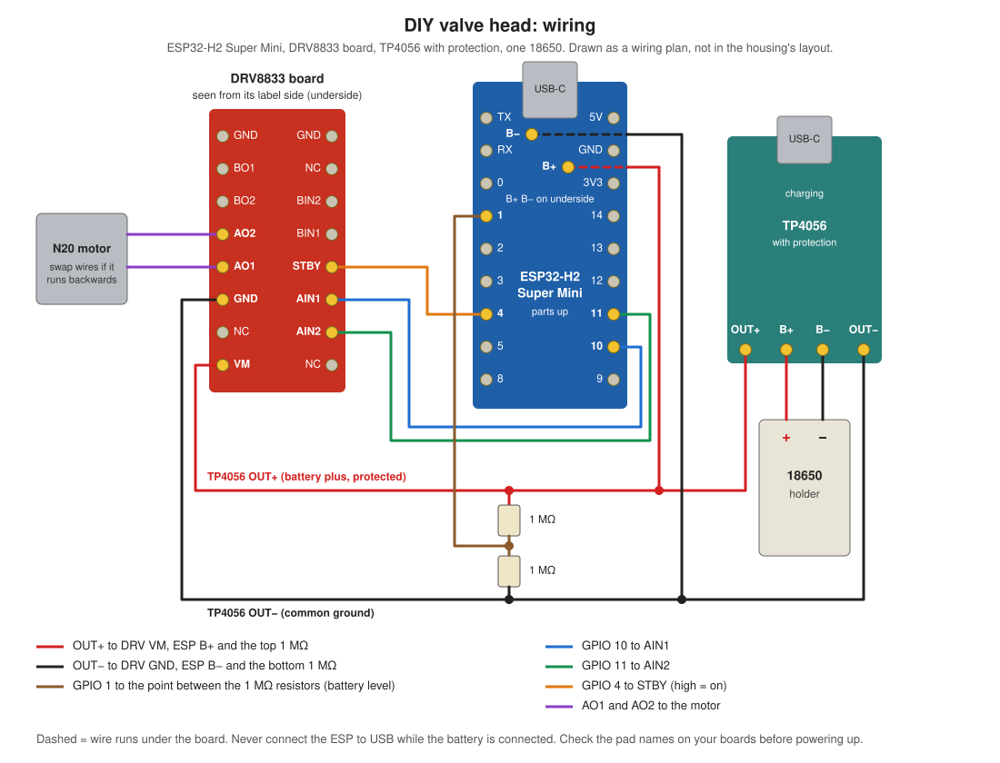

# DIY valve head for floor heating (battery, Matter)

A slim, battery-powered valve head for M30×1.5 floor-heating manifold valves. It is for manifolds where off-the-shelf heads (≈80–100 mm) stick out too far.

Layout along the body: **drive | battery**, with the [motor board](../motor-board) over the battery.

- **Drive:** an N20 lock motor stands upright at the valve end. Its lead screw points straight at the valve pin. The nut sits in a printed pusher that presses the pin directly. The drive column keeps the pusher from turning, and its round tip runs in the adapter's bore, so the adapter can turn around it. The lead screw holds its position, so the valve stays put with no power.
- **Brain:** ESP32-H2 Super Mini as a sleepy **Matter-over-Thread** end device. It shows up in Home Assistant's Matter integration as a valve (open/closed) with a battery level, and Home Assistant sets each head based on a room sensor. Pairing is over Bluetooth with the Matter QR code, the same as any store-bought Matter device.
- **Power:** one 18650, with USB-C charging through a socket in the back wall. The motor runs directly from the cell (3–4.2 V).
- **Housing:** a one-piece **tray** (printed front-face-down, open towards the valve), a **lid** on the valve side that slides in from the back, an **adapter** that screws into the tray with a coarse left-hand thread (0.6 turn), a separate **ring nut** that turns freely around it and clamps it to the valve. The board presses into a pocket in the tray, and the battery keeps it there. No screws, no clips across a seam, no supports.
- **Size (defaults):** 26 × 104.7 mm, **37.5 mm deep** from the valve's thread face.

The model is [`valve_head_tray.scad`](valve_head_tray.scad), the firmware is in [`firmware/`](firmware) and can be flashed straight from the project page in the browser. The version for loose bought boards is [`versions/loose-boards/valve_head_tray.scad`](versions/loose-boards/valve_head_tray.scad), and the older left/right clamshell version is [`versions/clamshell/valve_head.scad`](versions/clamshell/valve_head.scad).


How it goes together: the tray lies front face down, everything goes in from the valve side, the adapter screws in, the lid slides on, the ring nut goes on from the valve side:


Section through the valve axis, open (nut up at the gear plates) and closed (nut and pusher 3.4 mm down, pin pushed in). The front face is at the top, the valve at the bottom right:


## Measure first

All values marked `MEASURE` in [`valve_head_tray.scad`](valve_head_tray.scad) are placeholders:

| Parameter | What to measure |
|---|---|
| `valve_spacing` | centre-to-centre distance between valves |
| `depth_avail` | free space from the thread face to the cabinet door / wall |
| `thread_len` | length of the external M30 thread on the valve |
| `pin_top` | pin tip above the thread face, not pressed (negative if recessed) |
| `valve_stroke` | how far the pin goes in until it stops (press firmly) |
| `gp_*`, `mot_*`, `scr_*`, `nut_*` | the lock motor: gear plate size, motor can size, motor-to-screw distance, screw length/diameter, nut size. The seller gives no drawing, so these are guesses from the photo. Motor can + gear plates are 24 of the 37.5 mm depth |
| `brd_*`, `esp_*`, `btn_*` | the [motor board](../motor-board) and its Super Mini: size, height of the parts under and over it, and where the BOOT and RESET buttons sit (from the board's centre line and from the Super Mini's USB-C end, scaled from the seller's photo). Stops cover 1 × 0.5 mm at each corner, and the pin holes in the front face sit over the buttons |
| `cell_d`, `cell_len`, `cell_nub` | your 18650 (set to 18.4 × 65, 0.5 nub; a protected cell is up to 70 long) |
| `con_dome` | height of the button plate's dome (set to 1). Plate 12 × 12 × 0.3 and a spring that is solid at 5 mm are measured |
| `usb_*` | the USB-C snap socket: opening in the back wall, wall thickness for its snaps, and how far it reaches inside |

The model prints depth, size and pusher position. It stops with an error if something doesn't fit, for example if the screw is too short or too long, or the adapter's wall gets too thin.

## Printing

```bash
openscad -D 'part="tray"' -o tray.stl valve_head_tray.scad
```

Parts: `tray`, `lid`, `adapter`, `pusher`, `nut` (or `print` for all of them on one plate). Ready to print in [`stl/`](stl): one STL per part, and all of them on one plate in `stl/valve_head_tray_plate.3mf` (~45 cm³, roughly 40–55 g of PETG depending on infill). `assembly`, `exploded` and `section` are only for checking. Add `-D show_travel=3.4` to see the closed position.


- **PETG or ASA, not PLA.** The manifold runs at 35–45 °C and PLA creeps.
- **Nut:** 0.12–0.16 mm layers, 4 perimeters. **Print the nut first** and test it on the valve. If the thread is too tight or too loose, change `clr` and reprint it. Best orientation: lip on the bed, as the export gives it. The lip underside is a 45° cone (and the adapter flange has a matching one), so it prints without a sagging ledge.
- **Adapter:** flange down, thread up, as exported. The thread is coarse (pitch 4, two starts, 45° flanks), so 0.2 mm layers are fine: each ridge is about 10 layers thick. If it is too tight or too loose in the tray, change `bt_gap` and reprint only the adapter. `bt_gap = 0.25` is an estimate until the test pieces are printed: `thread_test.scad` makes a tray coupon and plugs at 0.15–0.40.
- **Tray:** front face down, as exported. The walls, the drive column and the boards' pockets stand upright. The only overhangs are small: the wall grooves for the lid (0.9 mm). The boards are a press fit: if they are too tight or too loose, change `board_fit` and reprint the tray. The ears' 1 mm cover over the thread is a short bridge.
- **Lid:** flat, 2.4 mm thick, its bottom (outer) face down. The spring tab at its back end is its upper 1.2 mm layer, bridged over a 6.8 mm recess.
- **Pusher:** standing on its tip, with a brim: it's 23 mm tall on a 10 × 4.5 mm tip.

Nothing crosses a seam, so nothing is loaded across the layer lines: the tray is one piece, the lid is only a cover, and the motor's push goes from the gear plates into the tray's front face, through the walls into the left-hand thread and the adapter.

## Putting it together

1. **Drive unit, in your hand:** thread the brass nut onto the lead screw. Push the pusher up the screw from below until the nut drops into its hex pocket (turn the nut a little until it lines up; the pocket has a lead-in). A drop of glue keeps it there.
2. **Tray front face down**, open side up. Push the drive unit in, gear plates first: it goes into the column at the valve end until the gear plates sit against the front face, the motor can beside the screw. Run the motor wires through the slot towards the boards.
3. **Contact plates and board:** snip the plates' solder tabs to 4.5 mm, solder their wires, and press them into their seats from the valve side until they stop: the spring plate at the drive column, the button plate at the back wall. Then the board: solder the wires first, and insulate its underside (or the battery) with a layer of tape: its parts sit 0.2 mm over the battery. It lies flat, Super Mini towards the front face, wire pads towards the drive column. Press it into its pocket until it stops against the stops at its corners. To take it out, pull it out by its edges. The motor wires go up in the gap in front of it. The BOOT and RESET buttons are now under the two pin holes in the front face. **USB-C socket:** snap it into the back wall from inside.
4. **Cell** into the bay under the board, its + towards the back wall as marked on the lid; nothing stops it going in backwards, so check before closing. It stops the board from dropping out.
5. **Adapter:** screw it into the hole at the valve end, over the pusher's tip, **counter-clockwise** seen from the valve side (left-hand thread), about 0.6 turn, until its shoulder sits firmly against the tray's bottom face.
6. **Lid:** slide it in from the back end, along the grooves at the bottom of the side walls, until the tab at its back end clicks into the back wall.
7. **Ring nut:** push it over the adapter's flange from the valve side, lip towards the head. It turns freely around the adapter.
8. Hold the head at the angle you want, and screw the ring nut onto the valve. The adapter doesn't have to turn. The nut's drag on the flange can only tighten the left-hand thread.

**To take it off the valve:** unscrew the ring nut. **To open:** press the lid's tab out of the back wall with a small screwdriver and slide the lid out to the back, unscrew the adapter clockwise (seen from the valve side). Everything else lifts out of the tray.

**Charging:** plug a USB-C cable into the port in the back wall; the head can stay on the valve. The Super Mini's own USB-C stays inside: to flash it, open the lid, take the battery out and pull out the board, never with the battery connected.

**Buttons:** the two pin holes in the front face (the outer face, away from the valve), near the middle of the body, are over the Super Mini's BOOT and RESET buttons (seen from outside with the valve end down: BOOT right, RST left, as the wire pads face the drive). Check on your board. Press with a paper clip or SIM pin, with the head on the valve. A short press on BOOT opens a pairing window; holding it for 10 s clears every pairing (see the [firmware](firmware)).

## Bill of materials

AliExpress prices are from October 2026 and change daily. Wires and the resistors are cut from packs, so they count only a few cents per head.

### Per head

| # | Part | Qty | Source | ~CHF |
|---|---|---|---|---|
| 1 | N20 lock motor with lead screw + nut, 3–4.2 V, 130 rpm | 1 | [AliExpress](https://de.aliexpress.com/item/1005007468668750.html) | 1–2 |
| 2 | ESP32-H2 Super Mini (Thread + Bluetooth for Matter) | 1 | [AliExpress](https://de.aliexpress.com/item/1005011976335819.html) | 0.91–9.42 |
| 3 | [Motor board](../motor-board), with its parts (not ordered or built yet) | 1 | order from the KiCad files | ? |
| 4 | Battery contact plates, 12 × 12 mm, spring + button | 1 of each | AliExpress | to add |
| 5 | USB-C snap socket, 2 wires, with its CC resistors | 1 | any | — |
| 6 | 18650 cell, Samsung 35E / LG MJ1 / Molicel | 1 | Galaxus or a Swiss battery shop, **not AliExpress** | 6–8 |
| 7 | Silicone wire 26–28 AWG, red + black | ~40 cm | any | — |
| 8 | Heat-shrink tube, 2–3 mm | ~5 cm | any | — |
| 9 | Printed tray | 1 | `stl/tray.stl` | — |
| 10 | Printed lid | 1 | `stl/lid.stl` | — |
| 11 | Printed adapter (left-hand thread into the tray) | 1 | `stl/adapter.stl` | — |
| 12 | Printed pusher | 1 | `stl/pusher.stl` | — |
| 13 | Printed ring nut (M30×1.5) | 1 | `stl/nut.stl` | — |
| 14 | PETG or ASA filament (all five printed parts) | 40–55 g | — | 1–1.50 |
| 15 | Drop of glue (CA) for the motor nut in the pusher | — | — | — |

The motor board's cost isn't known yet, so there's no total per head.

### Once for the system

| # | Part | Qty | Source | ~CHF |
|---|---|---|---|---|
| 1 | Thread border router: Home Assistant Connect ZBT-2, or an Apple TV 4K / HomePod mini / Nest hub you already have | 1 | Home Assistant shop / Galaxus | 0–45 |
| 2 | Room temperature sensor, any that Home Assistant sees (Matter-over-Thread, e.g. Aqara Climate Sensor W100, keeps it all on one network) | 1 per room | Galaxus | 7–35 |
| 3 | Phone with the Home Assistant app and Bluetooth, for pairing | 1 | — | — |
| 4 | USB-C data cable and Chrome or Edge on a computer, for flashing | 1 | — | — |

**Force:** the pusher presses the pin directly, so the motor has to supply the full closing force of the valve (often 80–120 N). The seller doesn't state the motor's force. **Test one motor against a valve before building more.**

## Wiring

Pairing and flashing are in [`firmware/README.md`](firmware/README.md). The same wiring as a KiCad schematic is [`electronics/valve_head.kicad_sch`](electronics/valve_head.kicad_sch), and it opens in the project page's viewer.

The board's wire pads, in a row at its end next to the drive column:

| Ref | Goes to |
|---|---|
| J1 | USB-C socket: VBUS, GND |
| J2 | 18650 contact plates: plus (button), minus (spring) |
| J3 | Motor (swap the two wires if it runs backwards) |

The encoder pads (J4) stay empty, and their parts stay off the board. Everything else is on the board, see [its README](../motor-board).

For a test with loose bought boards, before the motor board exists, use the [loose-boards tray](versions/loose-boards/valve_head_tray.scad) and this wiring:



**Charging:** through the USB-C socket in the back wall. The ESP's own USB port is inside, only for flashing, and never at the same time as the battery.

## How it moves

Both ends of the travel are **hard stops**: the nut against the gear plates for "open", the pusher's chamfered shoulder in the countersink of the adapter for "closed", so the closing force goes straight into the valve.

This is what the [firmware](firmware) does:

- **Close / open:** wake the DRV8833, drive the motor in the wanted direction for a fixed time (travel time + ~0.5 s), then sleep. At the end the motor stalls briefly against the stop, which lock motors are made for.
- Measure the travel time once (3.4 mm; depends on the screw pitch) and set the timeout from it.
- The push reaction goes from the gear plates into the tray's front face, through its walls into the left-hand thread, and through the adapter into the valve. The lid is not in that path.
- If the motor moves the wrong way the first time, swap its wires.

## Status

- Geometry checked in OpenSCAD: all parts render as valid solids. Checked: nothing collides when assembled, open or closed; the drive unit, the boards (pressed straight in), and the lid (slide in) all go in without hitting anything; the adapter's left-hand thread fits the tray's and catches when pulled, its shoulder stops it on the tray, and the nut turns freely around the flange and catches it.
- **Not printed or tested yet.** The motor dimensions and force are unknown until it arrives.
- Firmware: [`firmware/`](firmware), Matter over Thread with esp-matter: a Water Valve endpoint with a Power Source cluster for the battery, sleepy end device polling every 5 s. **Not run on hardware yet**; the motor travel time and battery life are not measured yet.
